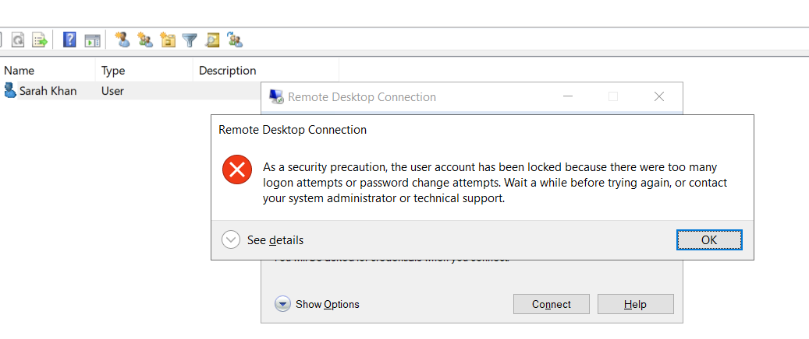
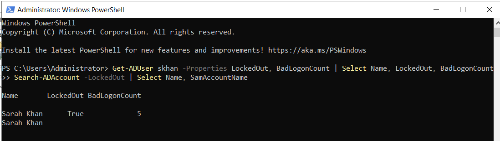
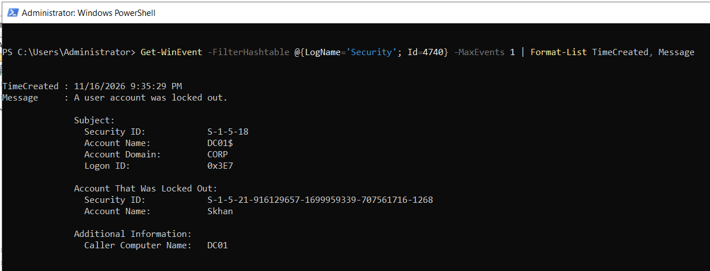
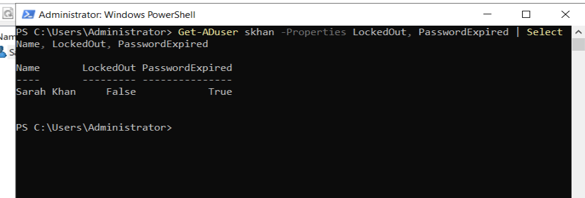
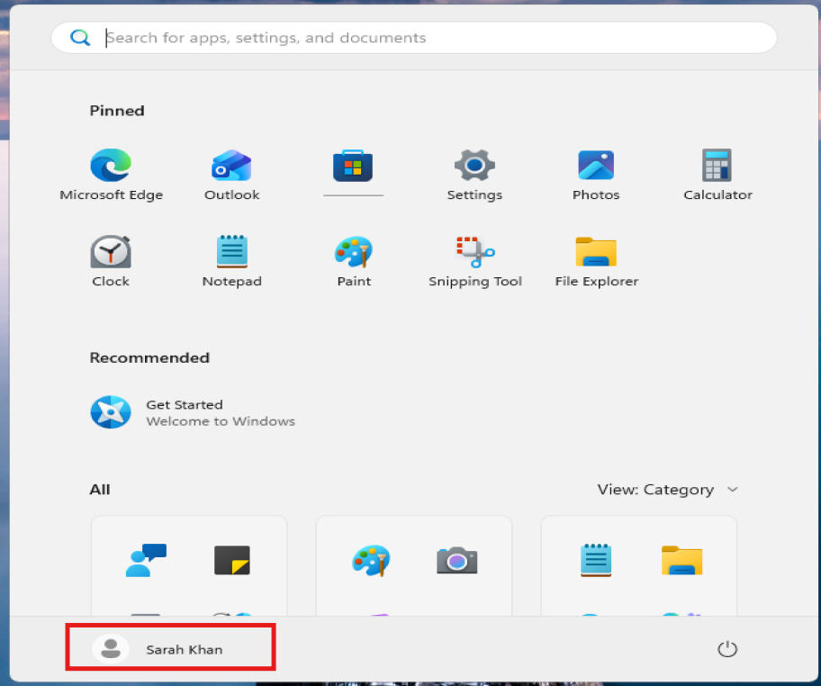
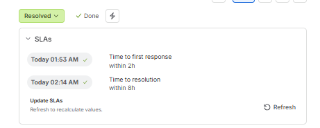

# IT-1: Can't log in (account lockout)

| Field | Value |
|---|---|
| Request type | Password reset (Service request) |
| Priority | High (P2) |
| Status | Resolved |
| Reported by | Sarah Khan (simulated user) |
| Top-60 reference | #21 Active Directory account locked |

## User report
"I came back from vacation today and my password isn't working. I tried it like 5 times and now it says my account is locked or something. I have a meeting at 2 and I need to get into my emai0l."

## Triage
One user cannot work and has a deadline, so High (P2). First response asked which account is affected, the exact error and whether she can receive a verification code.

## Reproduction (lab)
Domain lockout policy: 5 invalid attempts, 30 minute lockout. From a remote desktop session to CLIENT01 I entered a wrong password for `skhan` five times, then the correct password. The account was rejected as locked out even with the right password.

## Investigation
1. Confirmed the account state on DC01: `LockedOut: True`.

2. Checked the Security log for Event ID 4740 (account lockout). The caller computer was DC01, because the reproduction was run from DC01. On a real ticket this field shows which device is sending the bad passwords.

## Fix
1. Identity verification (employee ID, manager name) simulated for the lab.
2. In Active Directory Users and Computers: Reset Password, temporary password, "User must change password at next logon", and "Unlock the user's account".
3. Verified `LockedOut: False` and `PasswordExpired: True` (forced change pending).

## Verification
Signed in as the user at the CLIENT01 console, was prompted to change the password and reached the desktop.

## Root cause
Repeated failed sign-ins exceeded the lockout threshold. In the ticket story, the likely source is an old password saved on the user's phone; in the lab the bad attempts were typed deliberately.

## Prevention and follow-up
Ask the user to update saved passwords on all devices. If the lockout repeats, check Event 4740 for the caller computer to find the source. See the KB article "Unlock a locked account".

*Reproduced by me in a home lab (corp.local domain, DC01 and CLIENT01 virtual machines).*

