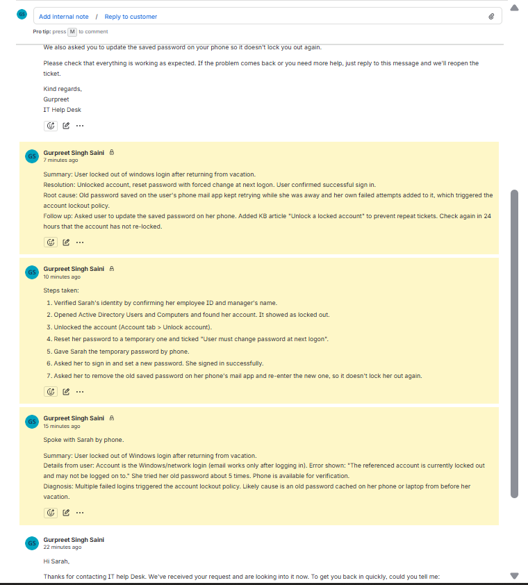

# IT-1: Can't log in (account lockout)

| Field | Value |
|---|---|
| Request type | Password reset (Service request) |
| Priority | High (P2) |
| Status | Resolved |
| Reported by | Sarah Khan (user) |

## User report
"I came back from vacation today and my password isn't working. I tried it like 5 times and now it says my account is locked or something. I have a meeting at 2 and I need to get into my email."

## Triage
One user cannot work, so High. First response sent with questions about the account, the exact error and phone access.

## Steps taken
1. Verified the user's identity before touching the account.
2. Located the account in Active Directory and confirmed it was locked out.
3. Unlocked the account and set a temporary password with "change at next logon".
4. User signed in and set a new password.
5. Asked the user to update the saved password on her phone.

## Resolution
Account unlocked and password reset. User confirmed signin.

## Root cause
An old password saved on the user's phone kept retrying while she was away, and her own failed attempts triggered the lockout policy.

## Follow-up
User updated the phone password. Check the account has not re-locked after 24 hours. See the KB article "Unlock a locked account".

## Screenshots

*Simulated scenario. The Active Directory steps will be performed in the corp.local lab (Pls see the AD Help Desk lab project).*
