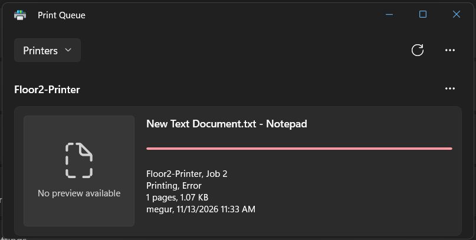
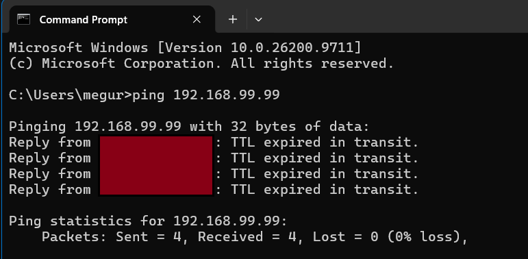
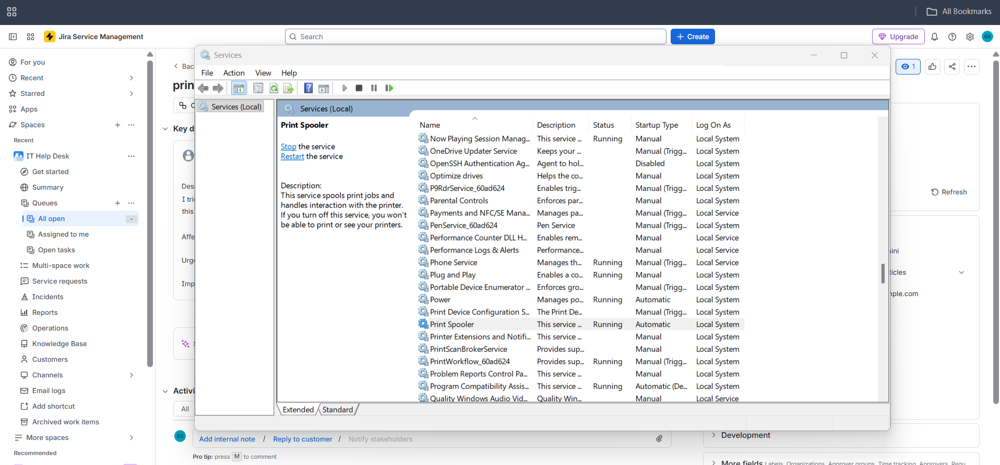
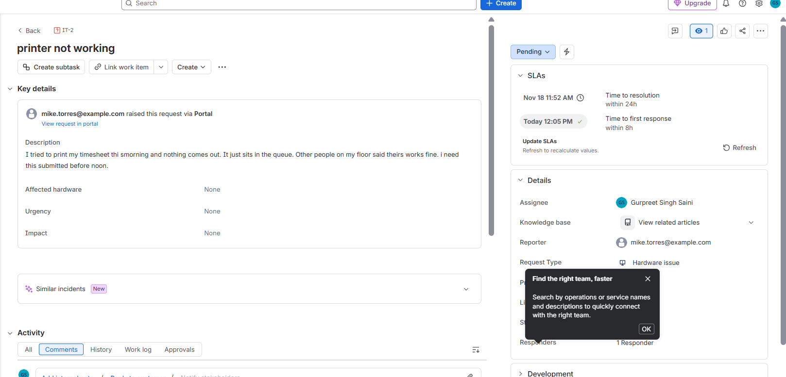

# IT-2: Printer not working

| Field | Value |
|---|---|
| Request type | Hardware issue (Incident) |
| Priority | Medium (P3) |
| Status | Pending (escalated to on-site support) |
| Reported by | Mike Torres (simulated user) |

## User report
"I tried to print my timesheet this morning and nothing comes out. It just sits in the queue. Other people on my floor said theirs works fine. I need this submitted before noon."

## Triage
Only one user affected and the user has a workaround (another printer), so Medium. First response sent within 13 minutes (target: 8 business hours).

## Steps taken
1. Asked the user for the printer name, any error message, and whether it worked earlier.
2. Reproduced the problem: a test job to the printer stayed in the queue.
3. Pinged the printer's IP address. The reply was "TTL expired in transit" from an upstream router, not from the printer, so the printer is not reachable.
4. Stopped the Print Spooler service, cleared the stuck job files, and restarted the service. Queue is now empty.

## Resolution
Stuck job cleared. The printer itself is unreachable, so the ticket was escalated to onsite support with the findings.

## Root cause
Printer not reachable over the network, so jobs queued and blocked.

## Follow-up
On-site team to check the printer's power, cable, and IP address. User advised to use another printer meanwhile.

## Screenshots

*Simulated scenario worked in a home lab. The printer is a deliberately unreachable test printer.*
