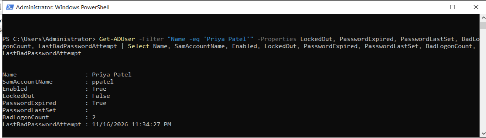
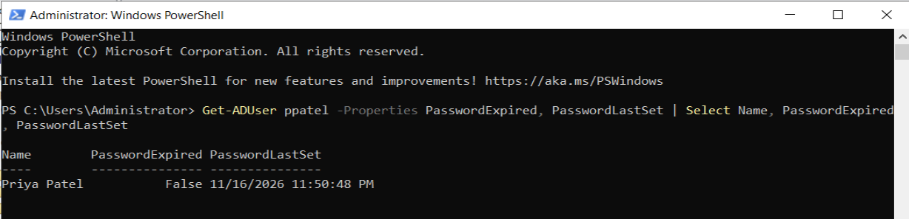
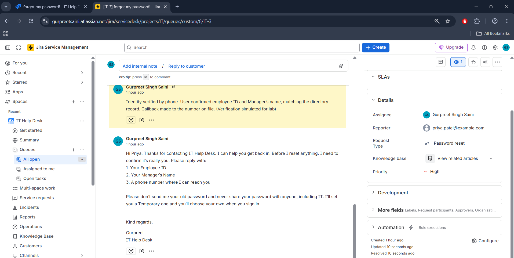
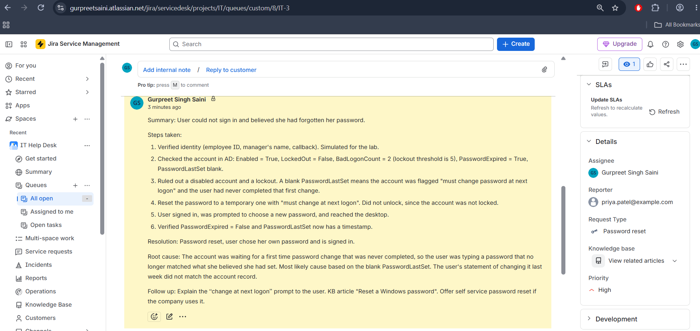
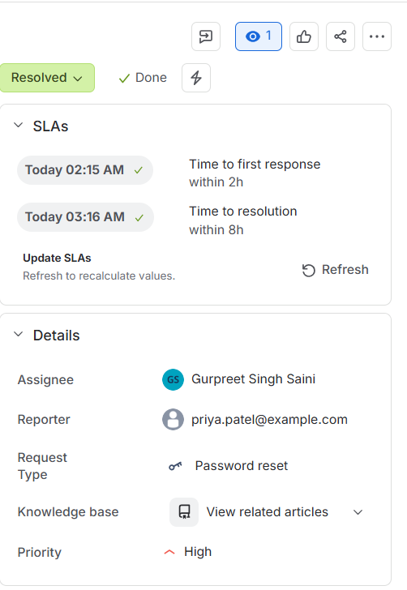

# IT-3: Forgot my password

| Field | Value |
|---|---|
| Request type | Password reset (Service request) |
| Priority | High (P2) |
| Status | Resolved |
| Reported by | Priya Patel (simulated user) |

## User report
"I changed my password last week and now I can't remember what I changed it to. I tried twice and it says wrong password. I need to get in to finish a report today."

## Triage
One user cannot work and has a deadline, so High (P2). First response asked her to verify her identity and reminded her never to share her password.

## Investigation
Checked the account in Active Directory before resetting anything:

| Check | Result | Meaning |
|---|---|---|
| Enabled | True | Not a disabled account |
| LockedOut | False | Not a lockout (2 bad attempts, threshold is 5) |
| PasswordExpired | True | Password needs changing |
| PasswordLastSet | blank | Flagged "must change at next logon"; the first change was never completed |

## Fix
1. Verified identity (simulated for the lab).
2. Reset the password to a temporary one with "User must change password at next logon". Did not unlock, because the account was not locked.
3. User signed in at the CLIENT01 console, chose a new password and reached the desktop.

## Verification
`PasswordExpired: False` and `PasswordLastSet` now holds a timestamp.

## Ticket handling in Jira
Acknowledged with an identity verification request, documented in internal notes and resolved with a plain language reply to the user.

## Root cause
The account was waiting for a firsttime password change that was never completed, so the password the user was typing did not match what she believed she had set. Most likely cause, inferred from the blank PasswordLastSet.

## Prevention and follow up
Explain the forced change prompt to users. See the KB article "Reset a Windows password".

*Reproduced in a home lab (corp.local domain, DC01 and CLIENT01 VMs).*
