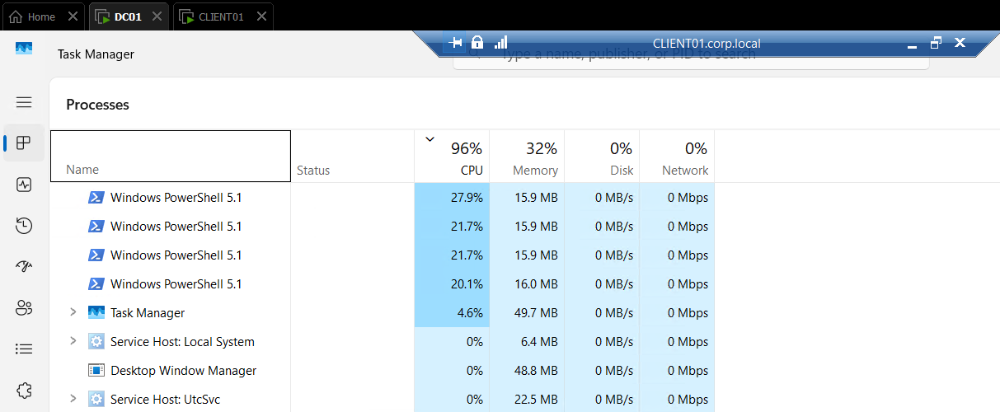
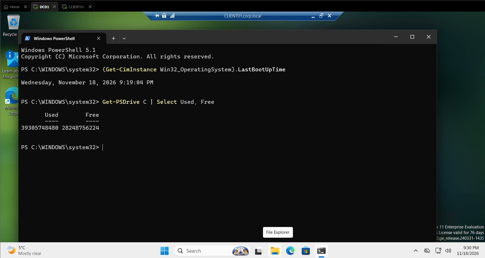
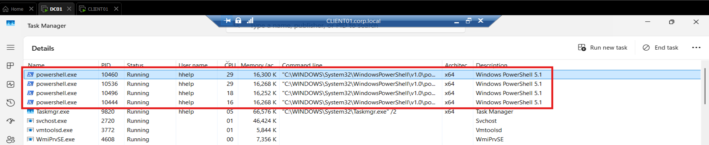
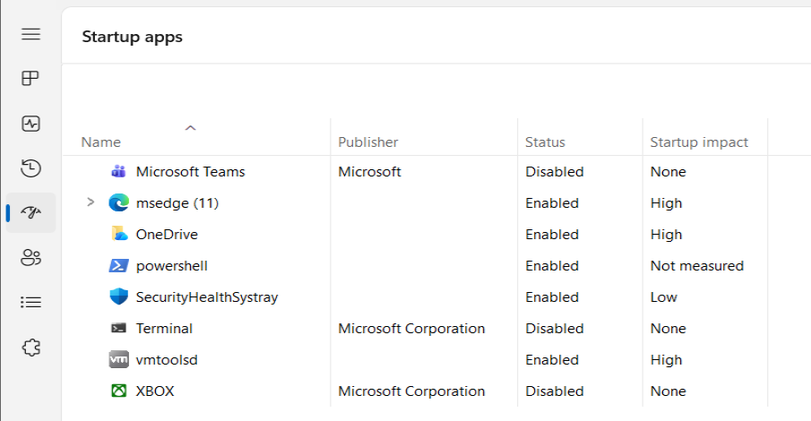
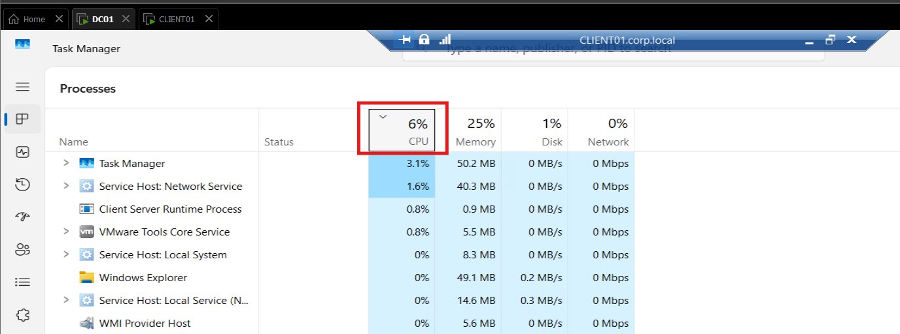
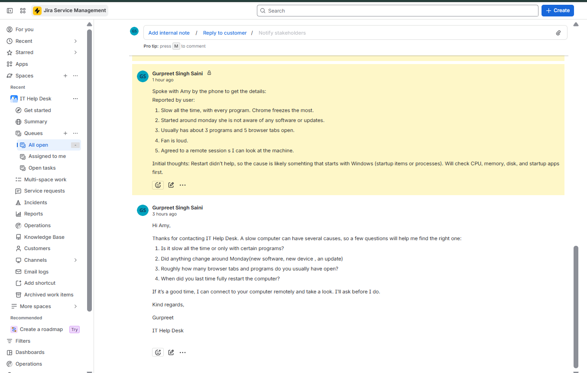
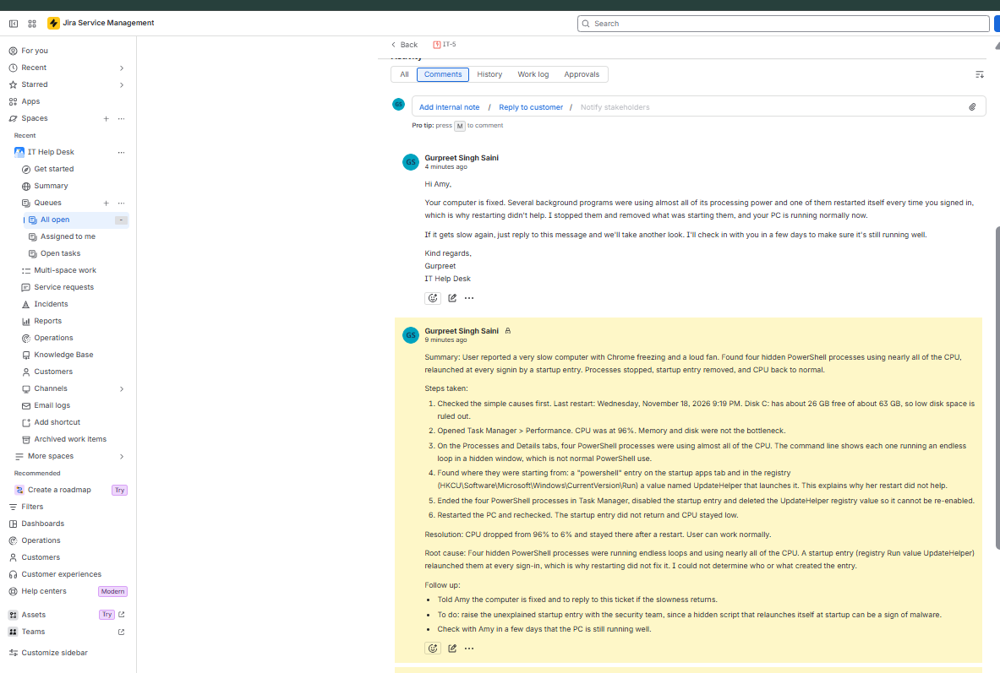

# IT-5: Computer is super slow

| Field | Value |
|---|---|
| Request type | Report a system problem (Incident) |
| Priority | Medium (P3) |
| Status | Resolved |
| Reported by | Amy Chen (simulated user) |

## User report
"My computer has been really slow since Monday. Everything takes forever to open, Chrome freezes and the fan is really loud. I restarted it once and it didn't help. I have a lot of work to get through today and I can't work like this."

## Triage
One user affected and she can still work, slowly, so Medium (P3). First response asked whether it is slow all the time, what changed around Monday, how many programs she keeps open, and when she last restarted. It also asked permission for a remote session.

## Investigation
Worked through the method: check the simple causes, isolate the bottleneck, find the culprit, find its source.

| Check | Result | Meaning |
|---|---|---|
| Last restart | Wednesday, November 18, 2026, 9:19 PM | Recently restarted, so not a long uptime problem |
| Free disk space (C:) | about 26 GB of about 63 GB | Low disk space ruled outt |
| CPU | 96% | CPU is the bottleneck, not memory or disk |
| Top processes | Four PowerShell processes using almost all of the CPU | Not normal for Powershell |
| Command line | Endless loop in a hidden window | Not legitimate use |

Why a restart did not help: the Startup apps tab and the registry Run key (`HKCU\Software\Microsoft\Windows\CurrentVersion\Run`, value `UpdateHelper`) relaunched the processes at every sign-in.

## Fix
1. Ended the four PowerShell processes in Task Manager.
2. Disabled the startup entry (reversible first step).
3. Deleted the `UpdateHelper` registry value so nothing can re-enable it.
4. Restarted the PC and rechecked.

## Verification
CPU dropped from 96% to 6% and stayed low after a restart. The startup entry did not return.

## Ticket handling in Jira

## Root cause
Four hidden PowerShell processes were running endless loops and using nearly all of the CPU. A registry startup entry relaunched them at every sign-in, which is why restarting did not fix it. I could not determine who or what created the entry.

## Prevention and followup
- Raise the unexplained startup entry with the security team: a hidden script that relaunches itself can be a sign of malware.
- Check with the user in a few days that the PC is still running well.
- Before disabling startup items, confirm they are not needed. Several high-impact entries here (Edge, OneDrive, VMware Tools) were legitimate and left alone.
- See the KB article and troubleshooting guide for the "slow computer" method.

## Lab reproduction
To practice this ticket, I created the problem on a lab VM (CLIENT01, corp.local domain): four hidden PowerShell processes running endless loops, plus a registry Run entry to relaunch them at signin. I then diagnosed and fixed it as described above, connecting by Remote Desktop from the domain controller. In a real ticket the remote session is made with the user's permission.

*Reproduced in a home lab (corp.local domain, DC01 and CLIENT01 virtual machines).*
